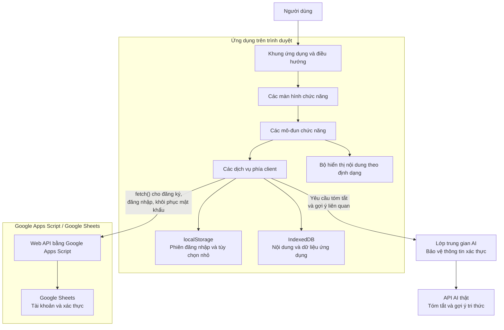
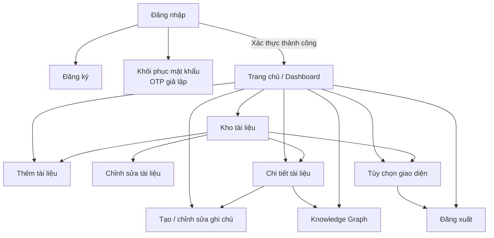
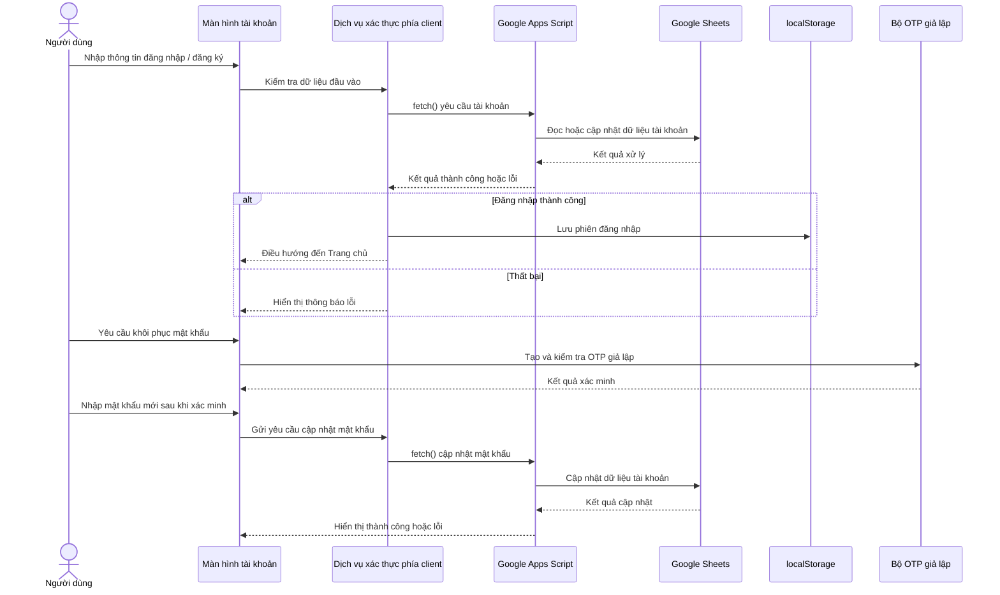
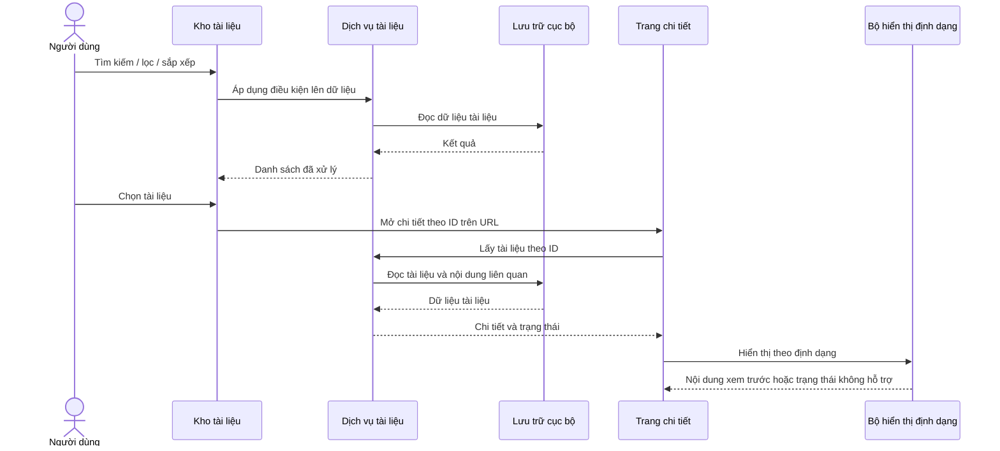
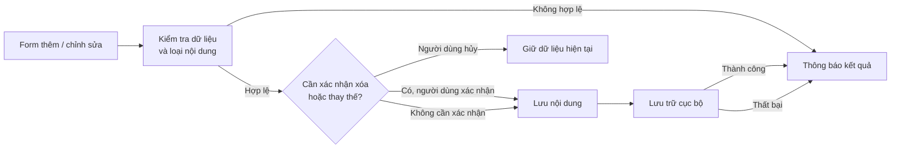

# Sơ đồ thiết kế kỹ thuật

## 1. Mục đích và phạm vi

Tài liệu này mô tả kiến trúc giao diện và các luồng chức năng của Personal Knowledge Base dựa trên [`user-stories.md`](./user-stories.md) cùng các quyết định phạm vi đã được xác nhận. Ứng dụng được định hướng chạy trên trình duyệt với HTML, CSS và JavaScript thuần; các thao tác tìm kiếm, lọc và cập nhật giao diện diễn ra phía client.

Những lựa chọn kỹ thuật chưa được xác định được ghi rõ là **chưa chốt**, không mặc định triển khai theo một phương án cụ thể.

## 2. Sơ đồ kiến trúc tổng thể



### Trách nhiệm các lớp

| Lớp | Trách nhiệm |
|---|---|
| Khung ứng dụng | Điều hướng giữa màn hình, cung cấp khu vực nội dung và các lối truy cập chức năng. |
| Màn hình | Thu thập thao tác người dùng, hiển thị dữ liệu, trạng thái rỗng, thành công và lỗi. |
| Mô-đun chức năng | Điều phối nghiệp vụ của tài khoản, kho tài liệu, ghi chú, tìm kiếm, tùy chọn và sơ đồ tri thức. |
| Dịch vụ phía client | Gửi yêu cầu xác thực và yêu cầu AI qua lớp trung gian; đọc/ghi dữ liệu cục bộ; tìm kiếm, lọc, sắp xếp; lưu tùy chọn; trả kết quả để giao diện cập nhật. |
| Bộ hiển thị nội dung | Chọn cách xem trước phù hợp với loại tài liệu và cung cấp thông báo nếu không thể xem trước. |
| Google Apps Script / Sheets | Xử lý các yêu cầu tài khoản: đăng ký, đăng nhập và cập nhật mật khẩu sau khi hoàn tất OTP giả lập. |
| Lớp trung gian AI | Chuyển tiếp yêu cầu tới nhà cung cấp AI thật; giữ thông tin xác thực ở phía máy chủ, không gửi khóa bí mật xuống trình duyệt. |
| API AI | Tạo bản tóm tắt tài liệu và đề xuất liên kết tri thức phù hợp với chủ đề. |

## 3. Sơ đồ màn hình và điều hướng



Các màn hình con như form thêm/sửa, hộp xác nhận, bộ lọc và vùng xem trước có thể được trình bày trong màn hình chức năng tương ứng; user stories không bắt buộc chúng phải là trang riêng.

Đăng nhập và khôi phục mật khẩu là luồng demo. Nội dung trong IndexedDB không được phân vùng theo tài khoản; đăng xuất không xóa dữ liệu và tài khoản khác dùng cùng hồ sơ trình duyệt vẫn có thể truy cập nội dung đó. Không mô tả Auth Guard phía client như một ranh giới bảo mật.

## 4. Màn hình và nội dung

| Màn hình lớn | Màn hình nhỏ / khu vực | Nội dung và thao tác chính |
|---|---|---|
| **Tài khoản** | Đăng nhập | Tên đăng nhập, mật khẩu; gửi yêu cầu xác thực; liên kết đăng ký và khôi phục mật khẩu; hiển thị lỗi xác thực. |
| | Đăng ký | Thông tin đăng ký như tên đăng nhập, mật khẩu, email; kiểm tra dữ liệu; báo thành công hoặc lỗi trùng tên đăng nhập. |
| | Khôi phục mật khẩu | Nhập thông tin tài khoản, xác minh bằng OTP giả lập, nhập mật khẩu mới; hiển thị kết quả cập nhật. |
| **Trang chủ / Dashboard** | Tài liệu mới thêm | Thẻ tài liệu gồm thông tin cơ bản; chọn thẻ để mở chi tiết. |
| | Vừa mới xem | Thẻ tài liệu vừa được mở gần đây, kèm thông tin cơ bản; chọn thẻ để mở chi tiết. |
| | Thống kê kho | Hiển thị riêng số tài liệu và ghi chú, cùng số lượng tài liệu theo loại; không tính tài liệu đã xóa khỏi kho hoạt động. |
| | Truy cập nhanh | Lối vào Kho tài liệu, Thêm tài liệu, Tạo ghi chú và Tìm kiếm. |
| **Kho tài liệu** | Thanh tìm kiếm và gợi ý | Tìm theo từ khóa; gợi ý từ khóa hoặc định dạng phù hợp với dữ liệu. |
| | Bộ lọc | Lọc theo từ khóa, định dạng, tag; kết hợp tìm kiếm và lọc không tải lại toàn bộ trang. |
| | Điều khiển hiển thị | Chuyển đổi Card/List; sắp xếp theo tên, ngày thêm, ngày cập nhật; chọn số mục mỗi trang: 10, 20, 50 hoặc tất cả (all). |
| | Danh sách kết quả | Tài liệu và ghi chú độc lập, hiển thị dạng thẻ hoặc danh sách; tag và thông tin phù hợp; thao tác mở, sửa hoặc xóa. Ghi chú vẫn là entity riêng, không chuyển thành Document. Hiển thị trạng thái rỗng khi không có kết quả. |
| | Quản lý tag | Tạo và chọn tag; hiển thị tag; chỉnh sửa/xóa tag và xử lý tài liệu liên quan nhất quán. |
| | Quản lý thư mục | Tạo, đổi tên, xóa thư mục rỗng; xem tài liệu theo thư mục. Nếu còn tài liệu hoặc thư mục con, hướng dẫn di chuyển chúng trước khi cho phép xóa. |
| **Thêm / chỉnh sửa tài liệu** | Thông tin chung | Tiêu đề, mô tả, tag và thông tin phân loại phù hợp với loại nội dung; kiểm tra trường bắt buộc. |
| | Tệp tải lên | Chọn tệp, xem thông tin cơ bản, kiểm tra định dạng/dung lượng; xác nhận trước khi thay thế; báo lỗi nếu lưu thất bại. |
| | URL | Tên hiển thị, URL, mô tả và tag; kiểm tra định dạng URL; cho phép mở liên kết. |
| | Ghi chú độc lập | Tiêu đề và nội dung; có thể thêm mô tả/tag nếu được hỗ trợ; lưu để xuất hiện trong kho. |
| **Chi tiết tài liệu** | Thông tin tài liệu | Tiêu đề, ngày tạo, tag và nội dung tương ứng; định danh tài liệu lấy từ URL. |
| | Trạng thái và thao tác | Đánh dấu/bỏ yêu thích; cập nhật trạng thái Chưa đọc/Đang đọc/Đã đọc; sửa hoặc xóa tài liệu. |
| | Trình xem nội dung | Văn bản/Markdown, ảnh/lightbox, PDF, DOCX, bảng tính, EPUB, video hoặc thông báo không hỗ trợ xem trước. |
| | Ghi chú và highlight | Tạo và quản lý nhiều ghi chú trên cùng một tài liệu; giữ ghi chú tách biệt với nội dung gốc. |
| | Tóm tắt AI | Gửi yêu cầu đến API AI thật, hiển thị trạng thái chờ và kết quả; cho phép lưu kết quả thành ghi chú gắn với tài liệu. |
| | Liên kết tri thức | Hiển thị tài liệu liên quan/backlinks từ cú pháp `[[...]]` và các gợi ý liên quan chủ đề do AI đề xuất. |
| **Ghi chú** | Danh sách ghi chú của tài liệu | Hiển thị nhiều ghi chú thuộc cùng tài liệu trong trang chi tiết; thao tác sửa/xóa từng ghi chú. |
| | Form ghi chú | Nhập tiêu đề/nội dung; lưu ghi chú độc lập hoặc ghi chú gắn với tài liệu. |
| **Knowledge Graph** | Sơ đồ nút và liên kết | Hiển thị tài liệu, tag và ghi chú thành các nút, quan hệ đã xác nhận thành các cạnh; AI gợi ý liên kết theo chủ đề để người dùng xem xét; phóng to/thu nhỏ, kéo thả và chọn nút để mở nội dung. Dùng vis-network ở dạng thư viện trình duyệt không cần bước build. |
| | Bộ lọc và gợi ý | Tìm kiếm/lọc nút theo loại hoặc tag; xem gợi ý AI riêng với liên kết đã xác nhận; chấp nhận hoặc từ chối từng gợi ý. |
| **Tùy chọn giao diện** | Giao diện | Chuyển sáng/tối và lưu lựa chọn. |
| | Tùy chọn hiển thị | Ghi nhớ các tùy chọn hiển thị được hỗ trợ, gồm Card/List và số mục hiển thị; lưu trong localStorage, mặc định 10 mục/trang. |

## 5. Luồng chức năng chính

### 5.1 Xác thực



Auth Guard kiểm tra trạng thái phiên trong `localStorage` khi mở màn hình nội bộ. Đăng xuất xóa trạng thái phiên và đưa người dùng về màn hình đăng nhập; không xóa dữ liệu cá nhân đã lưu.

### 5.2 Kho tài liệu và xem chi tiết



### 5.3 Thêm hoặc cập nhật nội dung



### 5.4 Tóm tắt AI và gợi ý tri thức

```mermaid
sequenceDiagram
    actor User as Người dùng
    participant UI as Chi tiết tài liệu / Knowledge Graph
    participant AIService as Dịch vụ AI phía client
    participant Gateway as Lớp trung gian AI
    participant AI as API AI thật
    participant DB as IndexedDB

    User->>UI: Yêu cầu tóm tắt hoặc gợi ý liên kết
    UI->>AIService: Gửi nội dung/metadata cần phân tích
    AIService->>Gateway: Gửi yêu cầu AI
    Gateway->>AI: Chuyển tiếp yêu cầu
    AI-->>Gateway: Tóm tắt hoặc gợi ý theo chủ đề
    Gateway-->>AIService: Trả kết quả
    AIService-->>UI: Hiển thị kết quả
    opt Người dùng lưu tóm tắt
        User->>UI: Lưu kết quả thành ghi chú
        UI->>DB: Lưu ghi chú gắn với tài liệu
        DB-->>UI: Kết quả lưu
    end
    opt Người dùng xem xét gợi ý Knowledge Graph
        User->>UI: Chấp nhận hoặc từ chối gợi ý
        UI->>DB: Lưu quyết định; chỉ chấp nhận mới tạo liên kết đã xác nhận
        DB-->>UI: Cập nhật sơ đồ
    end
```

## 6. Bộ hiển thị nội dung theo định dạng

| Loại nội dung trong stories | Cách hiển thị được nêu |
|---|---|
| `.txt`, `.md`, `.markdown` | Văn bản thuần; Markdown dùng `marked.js`, có chế độ đọc và chỉnh sửa. |
| Ảnh `.jpg`, `.jpeg`, `.png`, `.webp`, `.svg` | Hiển thị bằng ``; mở Lightbox khi chọn ảnh. |
| `.pdf` | PDF.js; điều hướng trang trước/sau và tổng số trang. |
| `.docx` | mammoth.js để chuyển đổi và hiển thị nội dung HTML. |
| `.xlsx`, `.xls`, `.csv` | SheetJS (`xlsx`) để chuyển nội dung thành bảng HTML. |
| `.epub` | epub.js để hiển thị sách và điều hướng chương/trang. |
| `.mp4`, `.webm` | Phần tử `<video>` HTML5 với điều khiển phát. |
| Loại không xem trước được | Thông báo rõ tình trạng hỗ trợ; cung cấp tải về nếu phù hợp; không làm thay đổi tệp gốc. |

## 7. Dữ liệu và lưu trữ theo phạm vi stories

- Thông tin tài khoản được gửi qua Google Apps Script để xử lý với Google Sheets.
- Phiên đăng nhập được lưu trong `localStorage` theo yêu cầu đăng nhập.
- Tùy chọn giao diện/hiển thị được ghi nhớ trong `localStorage`, gồm số mục mỗi trang 10, 20, 50 hoặc tất cả; mặc định là 10.
- Dữ liệu nội dung ứng dụng được lưu trong `IndexedDB`, gồm tài liệu, ghi chú, tag, thư mục, trạng thái yêu thích/đọc, lịch sử vừa mới xem cần cho dashboard và dữ liệu tệp tải lên.
- Ghi chú là entity riêng; danh sách Kho có thể hiển thị ghi chú độc lập cùng tài liệu, nhưng thống kê phải phân biệt số tài liệu và số ghi chú.
- Đăng nhập demo không phân vùng nội dung IndexedDB theo tài khoản và không tạo kiểm soát truy cập an toàn. Dữ liệu cục bộ được dùng chung trong cùng hồ sơ trình duyệt.
- Nội dung đã lưu phải còn sau khi tải lại trang theo các tiêu chí chấp nhận tương ứng.

## 8. Các điểm chưa chốt

- **API AI:** nhà cung cấp và chi tiết triển khai lớp trung gian chưa được xác định. Không đặt khóa bí mật của API trong mã JavaScript phía trình duyệt.
- **OTP giả lập:** quy tắc tạo, thời hạn hiệu lực và cách nhập/xác minh OTP trong môi trường demo cần được xác định khi triển khai.
- **Dịch vụ tài khoản demo:** URL endpoint, quyền truy cập và định dạng request/response Google Apps Script cần được cung cấp; luồng này không cung cấp bảo mật cho dữ liệu nội dung cục bộ.